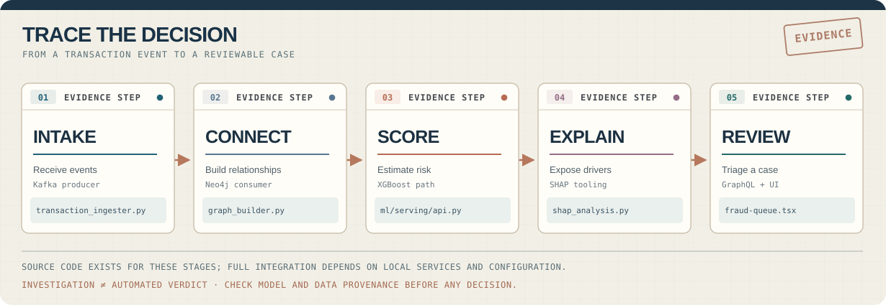
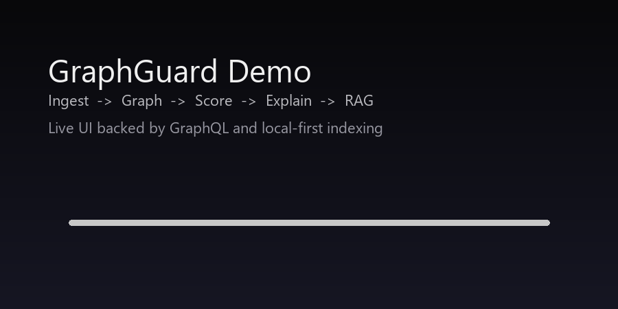

### GRAPHGUARD / THE EVIDENCE GRAPH

**Fraud rarely leaves a single clue. The important part is what the clues connect.**

A graph-informed fraud investigation project exploring **event ingestion, relationship analysis, XGBoost scoring, explainability and case review**.

[**Inspect the demo**](https://graph-guard-frontend.vercel.app) · [**Follow the evidence**](#follow-the-evidence) · [**Evidence register**](#evidence-register) · [**Run locally**](#open-the-case-locally)

The animated hero uses fictional entities and relationships. It is not live transaction data, a measured risk score or an actual investigation.

---

## Case opening / One event is not the whole story

Consider a **fictional example**: a purchase looks routine on its own, but the device appears on several accounts, which in turn connect to related merchants. Those relationships deserve inspection—not an automatic verdict.

> **Can we reveal the context behind a suspicious transaction, explain the model's reasoning and help an analyst decide what to examine next?**

GraphGuard's codebase explores that question. It separates **evidence**, **model output**, **explanation** and **reviewer action**. Some of the implementation is modular or local-first; not every service in the architectural vision is active in the hosted demo.

## Follow the evidence

Conceptual module map. This does not certify a complete live production pipeline.

<table>
<tr>
<td width="50%" valign="top">

**01 / What happened?**

The event producer provides the Kafka-facing intake path.

[Transaction producer](data-eng/producers/transaction_ingester.py) · [Event schema](data-eng/schemas/transaction_event.avsc)

</td>
<td width="50%" valign="top">

**02 / What's connected?**

The consumer and Neo4j tools reconstruct relationships that flat records can hide.

[Graph builder](data-eng/consumers/graph_builder.py) · [Graph algorithms](data-eng/neo4j/graph_algorithms.cypher)

</td>
</tr>
<tr>
<td width="50%" valign="top">

**03 / What is the estimated risk?**

XGBoost training and FastAPI scoring form the model-oriented path. Evaluation and calibration still matter.

[Model training](ml/training/train_xgboost_rigorous.py) · [Score endpoint](ml/serving/api.py)

</td>
<td width="50%" valign="top">

**04 / Why that output?**

SHAP tooling and explanatory charts make model contributions inspectable; an explanation is not causal proof.

[SHAP analysis](ml/explainability/shap_analysis.py) · [Explanation chart](frontend/src/components/dashboard/shap-chart.tsx)

</td>
</tr>
<tr>
<td colspan="2" valign="top">

**05 / What should the analyst review?**

The case queue, graph visualization and GraphQL models translate technical outputs into an investigation interface.

[Investigation desk](frontend/src/app/cases/page.tsx) · [GraphQL schema](backend/graphql/schema.py) · [Fraud queue](frontend/src/components/dashboard/fraud-queue.tsx)

</td>
</tr>
</table>

## Inside the investigation desk

Existing repository demo capture. The frontend contains sample cases and mock graph relationships, so a visible case is not necessarily a processed real transaction.

Beyond a generic analytics dashboard, the project includes a [demo view](frontend/src/app/demo/page.tsx), [case investigation page](frontend/src/app/cases/page.tsx), [network graph](frontend/src/components/dashboard/network-graph.tsx), [SHAP component](frontend/src/components/dashboard/shap-chart.tsx) and [local-first RAG assistant](frontend/src/components/assistant/rag-assistant.tsx).

### Hosted demo ≠ full local stack

| Where | What's represented |
| :--- | :--- |
| **Hosted project website** | Lightweight frontend experience; mocked/fallback data is possible. Current live integration was **not** independently checked for this README refresh. |
| **Local Docker services** | Compose files for PostgreSQL, Neo4j, Kafka, Flink and monitoring. Services require local resources and configuration. |
| **Python API and frontend** | Started separately; scoring, graph, model and RAG capabilities depend on credentials, services and available artifacts. |
| **Proposed hosted architecture** | Terraform and managed-service targets are plans/templates, not proof of completed production deployment. |

[Deployment reality check](docs/PRODUCTION_DEPLOYMENT.md) · [Implementation inventory](docs/PROJECT_CHECKLIST.md)

## Evidence register

**No claim without a trail back to code or an artifact.**

| Exhibit | Question | Evidence | Caveat |
| :--- | :--- | :--- | :--- |
| **E-01** | How do events enter the system? | [Producer](data-eng/producers/transaction_ingester.py) · [Consumer](data-eng/consumers/graph_builder.py) | Requires local services |
| **E-02** | How are patterns represented? | [Neo4j](data-eng/neo4j/) · [Flink](data-eng/flink/) · [Feature repo](data-eng/feast/feature_repo/) | Full pipeline not freshly verified |
| **E-03** | Where does scoring happen? | [Training](ml/training/train_xgboost_rigorous.py) · [API](ml/serving/api.py) | Model availability varies |
| **E-04** | Where are outputs explained? | [SHAP](ml/explainability/shap_analysis.py) · [UI](frontend/src/components/dashboard/shap-chart.tsx) | Not proof of causality |
| **E-05** | How does a case reach a reviewer? | [GraphQL](backend/graphql/resolvers.py) · [Case page](frontend/src/app/cases/page.tsx) | Case page includes mock data |
| **E-06** | How does repo-aware RAG work? | [Indexer](ml/serving/rag/indexer.py) · [RAG router](ml/serving/rag/router.py) · [Guide](docs/RAG.md) | Optional providers/settings |
| **E-07** | What testing exists? | [Python test log](docs/evidence/python-tests-20260124-210720.txt) · [API sample](docs/evidence/api-score-20260124-214043.txt) · [Audit](docs/FINAL_AUDIT.md) | Saved evidence, not live CI |

The saved test log reports **32 Python tests passing on January 24, 2026**; this is dated evidence rather than a current passing badge. The [source audit](docs/FINAL_AUDIT.md) explicitly records **GAT scoring as stubbed** and **Terraform as a template**.

## Open the case locally

The documented workflow uses **Docker Compose for supporting services**, with the Python API and Next.js interface started separately.

Prerequisites: Python 3.11+, a Node.js version compatible with Next.js 16, Docker/Compose for the backing stack, and enough system resources for the services selected.

~~~bash
git clone https://github.com/HuLaxx/GraphGuard.git
cd GraphGuard
cp .env.example .env
~~~

Configure local environment variables required by [Docker Compose](docker-compose.yml), including POSTGRES_PASSWORD, NEO4J_AUTH and GRAFANA_ADMIN_PASSWORD. Do not commit credentials.

~~~bash
# Optional backing services. May be resource-intensive.
docker compose up -d

# Python API from the repository root (another terminal).
python -m venv .venv
source .venv/bin/activate
pip install -e "./ml[dev]"
python -m uvicorn ml.serving.api:app --reload --port 8000

# Frontend from a separate terminal.
npm --prefix frontend install
npm --prefix frontend run dev
~~~

Windows venv activation: **.venv\Scripts\activate**. The API may need environment settings and keys for protected endpoints. Source-aligned commands above have **not** been re-tested end-to-end during this visual makeover.

| Local surface | URL |
| :--- | :--- |
| API reference | http://127.0.0.1:8000/docs |
| Health | http://127.0.0.1:8000/health |
| Frontend | http://localhost:3000 |

The optional [RAG assistant setup](docs/RAG.md) documents indexing, retrieval settings and providers separately.

### Scoring and investigation endpoints

| Route | What it exposes | Evidence |
| :--- | :--- | :--- |
| POST /score | Transaction scoring | [FastAPI](ml/serving/api.py) |
| GET /health | API health | [FastAPI](ml/serving/api.py) |
| GET /metrics | Prometheus metrics | [Monitoring](ml/monitoring/performance_monitoring.py) |
| POST /rag/ingest | Local RAG indexing | [Router](ml/serving/rag/router.py) |
| POST /rag/query | Ask over an index | [Router](ml/serving/rag/router.py) |

### Reproduce the checks

~~~bash
# After setting up Python dependencies
python -m pytest tests/unit/test_rag.py -v
python -m pytest tests/ -q

# In another terminal
npm --prefix frontend run test
~~~

These commands have **not** been executed during this README redesign. Historical logs and smoke results are stored in [docs/evidence](docs/evidence/).

## The unfinished case

Fraud investigation requires disciplined uncertainty: clear model provenance, measured errors, valid data, and a human review path.

- [x] Code paths for events, graph features, scoring, explanations and investigation interface.
- [x] Historical testing, API smoke logs and a source-level [audit](docs/FINAL_AUDIT.md).
- [x] Explicit separation of mocked UI cases, local services and proposed deployment.
- [ ] Replace/validate stubbed GAT scoring if that path is part of the intended application.
- [ ] Verify the full graph-to-score-to-review path in a reproducible environment.
- [ ] Re-run CI and publish traceable quality/coverage data; don't infer it from old logs.
- [ ] Evaluate precision, recall, false-positive costs and bias on labeled data before citing performance.
- [ ] Verify the hosted demo's actual integration boundaries and document them.
- [ ] Review old example credentials and secrets before any external deployment.

[Detailed implementation inventory](docs/PROJECT_CHECKLIST.md) · [Creative makeover checklist](docs/CREATIVE_CHECKLIST.md)

---

### THE EVIDENCE MATTERS MORE THAN THE ALERT.

A portfolio project by **Rahul Khanke / HuLaX**

[**Project website**](https://graph-guard-frontend.vercel.app) · [**Portfolio**](https://portfolio.hulax.uk/) · [**GitHub**](https://github.com/HuLaxx) · [**LinkedIn**](https://www.linkedin.com/in/rahul-khanke-853717218/)

Illustrative diagrams and sample data are not live risk judgments.

