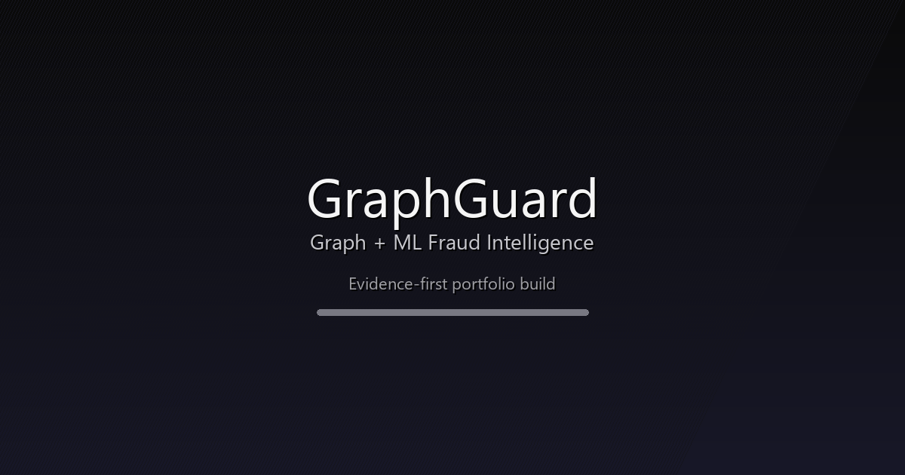

<div align="center">
  

  <a href="https://git.io/typing-svg">
    
  </a>

  <br />

  
  
  
  <br />
  
  
  
  
  

  <br /><br />

  <a href="#quick-start">Quick Start</a> | <a href="#evidence-map">Evidence Map</a> | <a href="#architecture">Architecture</a> | <a href="#api">API</a> | <a href="#testing">Testing</a> | <a href="#deployment">Deployment</a>
</div>

---

## Overview

GraphGuard is a portfolio-grade fraud detection platform that blends classic ML (XGBoost), graph analytics (Neo4j), and a local-first RAG assistant for repo-aware Q and A. The hosted demo is intentionally lightweight and uses free-tier services, while the full stack runs locally via Docker.

## Product Reveal

<div align="center">
  
  <br />
  
</div>

## Evidence Map

No claims without code. Each core capability maps to an implementation path.

| Capability | Evidence (path) |
| --- | --- |
| FastAPI scoring API | `ml/serving/api.py` |
| GraphQL schema + resolvers | `backend/graphql/schema.py`, `backend/graphql/resolvers.py` |
| Kafka ingestion and graph build | `data-eng/transaction_ingester.py`, `data-eng/graph_builder.py` |
| SHAP explainability + UI | `ml/explainability/`, `frontend/src/components/charts/` |
| Local-first RAG indexing | `ml/serving/rag/` |
| Frontend pages and UI | `frontend/src/app/` |

## Quick Start

### Prerequisites

- Docker Desktop
- Python 3.11+
- Node.js 18+ and pnpm

### 1) Start the local stack

```bash
cp .env.example .env

docker compose up -d
```

### 2) Run the API

```bash
python -m uvicorn ml.serving.api:app --host 127.0.0.1 --port 8000
```

If 8000 is busy, use 8010 and set the frontend proxy:

```bash
set NEXT_PUBLIC_API_PORT=8010
set API_PORT=8010
```

### 3) Run the frontend

```bash
pnpm -C frontend dev -- --port 3000
```

### 4) Optional: RAG indexing

```bash
curl -X POST http://127.0.0.1:8000/rag/ingest \
  -H "Content-Type: application/json" \
  -d '{"source_type":"repo","root_path":".","index":"graphguard"}'

curl -X POST http://127.0.0.1:8000/rag/query \
  -H "Content-Type: application/json" \
  -d '{"question":"How does Kafka flow into Neo4j?","index":"graphguard"}'
```

## Live Demo vs Local Stack

- Hosted demo (free tier): planned on Supabase, Upstash, and Railway with heavyweight services disabled.
- Full pipeline (local): Kafka, Neo4j, Spark, Flink, MLflow, and Grafana run via Docker Compose.

## Architecture

```
Sources -> Kafka -> Flink CEP -> Feature Store -> ML Scoring
                         |              |            |
                         |              |            +-> FastAPI + GraphQL
                         |              +-> Neo4j Graph
                         +-> Spark / Feast

UI (Next.js + D3) -> GraphQL -> Fraud Queue -> SHAP + RAG
```

## API

### REST (FastAPI)

| Method | Endpoint | Purpose |
| --- | --- | --- |
| POST | /score | Score a transaction |
| GET | /health | Health check |
| GET | /metrics | Prometheus metrics |
| POST | /rag/ingest | Build a local RAG index |
| POST | /rag/query | Query the RAG index |

### GraphQL (Strawberry)

```graphql
query FraudQueue {
  fraudQueue(status: PENDING, limit: 20) {
    items {
      id
      transactionId
      userId
      amountVal
      currencyCode
      riskScore
      decision
    }
  }
}
```

## Testing

Tests exist and run locally. Coverage reporting is not yet wired into CI.

```bash
pytest -q
pnpm -C frontend test
```

## Tech Stack

<div align="center">
  
</div>

## Deployment

Free-tier target deployment:

- Frontend: Vercel
- Backend: Railway
- Database: Supabase
- Cache: Upstash

The live demo should disclose free-tier limits and point users to local setup for the full experience.

## Documentation

| Document | Description |
| --- | --- |
| `docs/PORTFOLIO_CLAIMS.md` | Skills and claims by role |
| `docs/WORKFLOW_MAP.md` | Data flow and system integration |
| `docs/TECH_STACK.md` | Detailed technology inventory |
| `docs/DEPLOYMENT.md` | Deployment steps and environment vars |

## License

MIT (Portfolio project)

---

<div align="center">
  
  <br />
  <a href="https://hulax.vercel.app">Portfolio</a> | 
  <a href="https://github.com/HuLaxx">GitHub</a> | 
  <a href="https://www.linkedin.com/in/rahul-khanke-853717218/">LinkedIn</a> | 
  <a href="mailto:rahulkhane786@gmail.com">Email</a>
</div>
