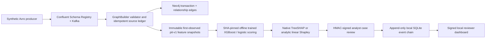
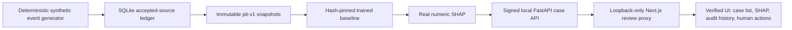

# GraphGuard — Verified synthetic architecture and demo reality

**Last inspected:** 17 November 2026. This document describes the current **stacked draft PRs**, not the default `main` branch or a production deployment.

## Full Docker-backed acceptance route (verified in CI)

The actual end-to-end **real Kafka + Schema Registry + Neo4j integration test** executes A→I with synthetic data in disposable CI services, including a signed analyst escalation, admin closure and replay. J is a **separately tested frontend connected to the same local review API**; CI does not currently run a complete Playwright browser against A→J. Do not claim that last browser-plus-broker step is tested until a real browser acceptance exists.

## Fast one-command local reviewer UI route

This quick-start **directly seeds the ledger** and intentionally **bypasses Kafka/Neo4j**. It is not a staged fake risk score: the trained synthetic baseline and real SHAP are executed against the accepted ledger snapshots. Keys/tokens are generated privately and stored in Git-ignored local files; hosted Next.js production builds disable the review bridge.

## Implemented-versus-claimed matrix

| Layer | Verified current scope | Not verified |
|---|---|---|
| Kafka ingestion | Actual registered Avro, source ledger, Neo4j, replay in disposable CI | Production-scale streaming, migrations, full rebalances |
| Graph features | Strict first-known-time `pit-v1` synthetic features | Globally distributed online store, public-data correctness |
| ML | Logistic and XGBoost trained/evaluated with chronological synthetic holdout and model artifact SHA-256 | Real fraud quality, calibration, cold-start generalization, approved model registry |
| SHAP | Native TreeSHAP additive log-odds and verified score reconstruction | Causal explanation, fairness guarantee, model-agnostic correlation-aware interpretations |
| Review auth | Signed short-lived local demo reviewer/admin tokens | Enterprise SSO/OIDC, MFA, revocation, robust rate-limiting |
| Audit | SQLite append-only trigger and HMAC hash-chain, corruption assertions | Independently anchored tamper-proof regulatory audit and retention |
| UI | Connected local signed API, numeric SHAP chart, actual review history, no mocked fallback | Browser-level source-to-screen E2E, public deployed authenticated investigator product |
| Cloud | None provisioned by this PR | Terraform apply, measured AWS bill, rollback/alarms |

## Model and ethics evidence

The generated dataset is deterministic **synthetic** with simulated labels, not a licensed external bank dataset. Original seed-42 held-out synthetic evaluation: XGBoost **PR-AUC 0.7650**, logistic **PR-AUC 0.6887**, XGBoost **test FPR 9.375%** despite 5% target on validation. These are not generalizable fraud detection rates. The SHAP chart reports signed additive contributions to **model log odds**; it is explicitly noncausal and cannot justify an automatic decision. User decisions are administrative investigation-state changes, not payment authorization or adverse action.

## Evidence map

- [PR #4 — real Avro and Kafka](https://github.com/HuLaxx/GraphGuard/pull/4)
- [PR #5 — first-known-time graph features](https://github.com/HuLaxx/GraphGuard/pull/5)
- [PR #6 — deterministic synthetic baselines](https://github.com/HuLaxx/GraphGuard/pull/6)
- [PR #7 — hash-pinned real model inference](https://github.com/HuLaxx/GraphGuard/pull/7)
- [PR #8 — native SHAP](https://github.com/HuLaxx/GraphGuard/pull/8)
- [PR #9 — signed local human case](https://github.com/HuLaxx/GraphGuard/pull/9)
- [PR #10 — actual connected local case UI and runner](https://github.com/HuLaxx/GraphGuard/pull/10)
- [P0–P4 verification register](ENGINEERING_RELEASE_CHECKLIST.md) and [local reviewer guide](LOCAL_REVIEW_DASHBOARD.md)

Production release still requires real security audits including npm advisory triage, stable dependency locks, outside-in browser tests, public licensed data, uncertainty/calibration, external identity and audit anchoring, measured performance and explicit cloud-deployment approval.
