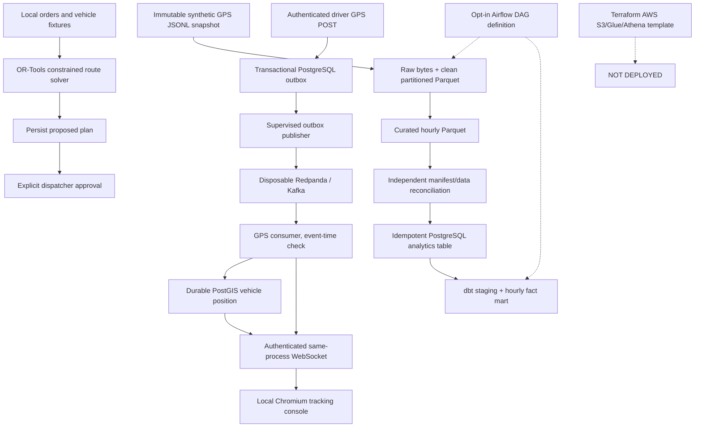

# FleetFlow — evidence-led engineering case study (November 2026)

**Positioning:** local-first event-driven logistics decision-support system
that investigates the journey from dispatch planning to GPS visibility and
reproducible operational analytics. The public portfolio/demo is **not** a
production logistics platform. Use current GitHub Actions and exact PR SHAs
before claiming any new milestone as verified.

## Product problem

A dispatcher needs feasible routes, approval control, a traceable record of
what was planned, and a way to observe vehicles after dispatch. A credible
prototype also needs to handle stale events, duplicates, failed publishes,
ambiguous authorization and missing data without suggesting routes or
performance numbers that have never actually been produced.

## Verified local architecture

**Arrows with ordinary lines** represent locally exercised implementation
paths in separate tests; they are not a claim that one continuous production
service orchestrates every path. **Dashed lines** represent reviewable but
unexecuted orchestration or cloud deployment. Parquet replay currently
starts with JSONL snapshots; a verified always-on Kafka-to-S3 sink does not
exist.

## Exact inspectable verification

| Slice | Evidence | Scope |
|---|---|---|
| Route and approval | [PR #5](https://github.com/HuLaxx/FleetFlow/pull/5), [PR #6](https://github.com/HuLaxx/FleetFlow/pull/6) | Persist planned routes separately from approval and record durable dispatch events; review stacked CI per PR |
| Local GPS and browser | [PR #9](https://github.com/HuLaxx/FleetFlow/pull/9), [backend CI 43927262604](https://github.com/HuLaxx/FleetFlow/actions/runs/43927262604), [real Chromium full-stack 43927262403](https://github.com/HuLaxx/FleetFlow/actions/runs/43927262403) | The exact PR #9 SHA `41a8a228` passed 101 backend tests (2 broker-only skips, 67% statement coverage), all five standard jobs, a real login → outbox → Redpanda → PostGIS → WebSocket → browser journey |
| Immutable Parquet and reconciliation | [PR #14](https://github.com/HuLaxx/FleetFlow/pull/14), [backend CI 44146640193](https://github.com/HuLaxx/FleetFlow/actions/runs/44146640193) | 112 backend tests passed (2 broker skips, 67% coverage); adversarial artifacts, keys, late events and curated aggregates checked |
| Actual dbt and SQL | [PR #15](https://github.com/HuLaxx/FleetFlow/pull/15), [dbt CI 44148239684](https://github.com/HuLaxx/FleetFlow/actions/runs/44148239684) | Actual PostgreSQL loader/dbt build after two idempotent imports: synthetic 3 accepted events, 1 late, 1 duplicate, 2 curated vehicle-hour rows; **12 dbt data tests passed** |
| Airflow DAG | [PR #16](https://github.com/HuLaxx/FleetFlow/pull/16), [Airflow DAG CI 44149282147](https://github.com/HuLaxx/FleetFlow/actions/runs/44149282147) | Verified DAG imports and four dependency edges; **actual scheduled full DAG execution not proven** |
| Chronological demand baselines | [PR #17](https://github.com/HuLaxx/FleetFlow/pull/17), [baseline CI 44150088642](https://github.com/HuLaxx/FleetFlow/actions/runs/44150088642) | **11 baseline tests passed**, deterministic synthetic one-step holdout, no-future-feature checks and a reproducible JSON report; not actual customer forecasting accuracy |
| AWS deployment definitions | [PR #18](https://github.com/HuLaxx/FleetFlow/pull/18) | Terraform review only, no AWS apply or paid resources; check exact-head offline CI separately |

## Design decisions and failure cases

1. **At-least-once events, not exactly-once claims.** Outbox rows are
   committed with business state, then published with broker ACK. A crash
   between ACK and SQL update may replay; consumers reject old or duplicate
   events. Failed payloads have a durable quarantine path.
2. **Unapproved is not deployed.** The optimiser computes route candidates
   with constraints; a dispatcher must explicitly approve persisted plans.
   Distance and travel-time assumptions are illustrative without verified
   routing-network input.
3. **Event time wins over delivery order.** A newer valid GPS event is never
   rolled back by an older packet; reconnects use PostgreSQL snapshots.
   Disconnected or older-than-60-second observations are not labelled live.
4. **Permissions apply to every path.** Driver/depot/admin scopes are checked
   against current database identity on snapshots/broadcasts; anonymous REST
   endpoints must not reveal coordinates. Session expiry and revocation are
   not automatically a production-grade distributed authorization system.
5. **Raw data is not the curated answer.** Event IDs, UTC timestamps,
   allowed lateness, partition dates, row-count/average reconciliation and
   immutable SHA256 artifacts make local backfills inspectable.
6. **Real tooling does not imply live production.** Actual Redpanda, PostGIS,
   Chromium, PyArrow, dbt and a real Airflow parser have CI evidence.
   There is no live AWS deployment, scheduled production pipeline,
   cross-instance WebSocket broadcast or trusted real-world efficiency gain.

### Reproduction entrypoints

- Real authenticated GPS browser test: [`.github/workflows/gps-full-stack.yml`](../.github/workflows/gps-full-stack.yml)
- PostGIS/Redpanda broker replay: [`.github/workflows/kafka-replay.yml`](../.github/workflows/kafka-replay.yml)
- Standalone Parquet replay: `cd backend && python -m src.lakehouse.replay --input /path/to/synthetic.jsonl --output /tmp/fleetflow-lake`
- Reconcile one run: `cd backend && python -m src.lakehouse.reconcile /tmp/fleetflow-lake/runs/<run-key>`
- Actual PostgreSQL/dbt acceptance: [`.github/workflows/p2-dbt-gps.yml`](../.github/workflows/p2-dbt-gps.yml)
- Opt-in local Airflow DAG: [`data-engineering/airflow/dags/gps_lake_pipeline.py`](../data-engineering/airflow/dags/gps_lake_pipeline.py)
- Terraform review only: [`infra/terraform/analytics/README.md`](../infra/terraform/analytics/README.md)

The synthetic fixture is original code-generated data; it is not derived
from a live customer's fleet. For raw GPS tracking outside local testing,
define consent, privacy policy, access logs and retention windows before
collecting any personally identifiable journeys.

## Hiring-manager and interview framing

**One-line summary:** Built a locally verified dispatch-to-tracking and
Parquet-to-dbt analytics prototype using OR-Tools, PostgreSQL/PostGIS,
transactional outbox, Kafka/Redpanda and a permission-scoped WebSocket.

**Interview story:** A genuine full-stack CI run originally failed while
seeding a login because a legacy Passlib/bcrypt combination had become
incompatible. After replacing new password hashing with Argon2id while
retaining legacy bcrypt verification, the browser login still failed from
a timezone-aware value being written into an existing timezone-naive
PostgreSQL column. Both problems were repaired and covered by real DB-backed
tests before the Kafka-to-browser acceptance passed. This is evidence
of engineering diagnosis and invariant testing, not a fabricated throughput
improvement or uptime result.

**Open release blockers:** Merge/review the stacked PRs; validate a single
clean-checkout command set; resolve the simplified `flink/` filename's
misleading implications; measure real throughput/latency and test faults;
execute the full Airflow task graph; evaluate routing against deterministic
nearest-neighbour baselines; verify domain-specific forecasting on
chronologically split real or permitted data; review retention and
distributed WebSocket authorization; explicitly approve AWS billing,
protected role and remote Terraform state before any deploy; validate a
real hosted demo and its sample/live labels.

This is **evidence-backed progress toward a 10/10 engineering target**, not
a universal 10/10 score or a guarantee of production readiness.
