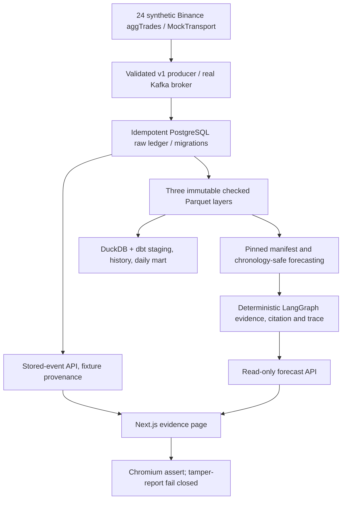

# Sentinance — local engineering release-candidate audit (20 November 2026)

**Scope:** Review-only [draft PR #35](https://github.com/HuLaxx/Sentinance/pull/35), stacked on #34 and previous PRs. This is not a production deployment or final merge. Claims below are restricted to **synthetic-data local CI**, with exact run IDs and source paths.

## Reviewer-verifiable golden path

### Evidence matrix — previously verified revision `fe44c78b584213cbfe86caa796cae467454315ac`

| Gate | Evidence and what actually ran | Status on that revision |
| --- | --- | --- |
| API, frontend and broker | [CI 44816859822](https://github.com/HuLaxx/Sentinance/actions/runs/44816859822): 463 API tests passed, 6 skipped, 5 warnings; Ruff, MyPy, frontend build/tests and broker success | **Passed** |
| Security, formatting, commit messages | [PR Checks 44816859916](https://github.com/HuLaxx/Sentinance/actions/runs/44816859916) | **Passed** |
| Frontend dependency audit | [Audit 44816859727](https://github.com/HuLaxx/Sentinance/actions/runs/44816859727) | **Passed** |
| Broker ACK, replay and persisted fixture ledger | [P1 44816859939](https://github.com/HuLaxx/Sentinance/actions/runs/44816859939) | **Passed** |
| Actual dbt/DuckDB on 24 synthetic minute bars | [P2 44816859900](https://github.com/HuLaxx/Sentinance/actions/runs/44816859900): two consecutive builds; 9/9 successful model/test operations each, 24 trades and 19 past-only calculated means, uploaded run results | **Passed** |
| Complete fixture-to-browser path | [P3 44816859968](https://github.com/HuLaxx/Sentinance/actions/runs/44816859968): 1 source→broker→DB→Parquet→forecast API→Chromium test, screenshot artifact; then tampered report fails closed | **Passed** |
| Cost-aware AWS analytics template | [P4 44816859844](https://github.com/HuLaxx/Sentinance/actions/runs/44816859844): terraform fmt, local schema init **without backend**, validate; no plan/apply | **Passed offline only** |

**New work after this baseline:** dependency-aware API readiness [code](../apps/api/readiness.py) and [tests](../apps/api/tests/unit/test_readiness_contract.py), plus [forecast error analysis](../apps/api/forecast_quality.py) and [3000-minute synthetic benchmark](../apps/api/benchmark_forecast_quality.py). Inspect the **latest PR SHA's** checks before claiming those are verified. Never substitute the older green runs for exact-head evidence.

## Reproduce and inspect

For source → broker → ledger → browser, follow [P1 local golden-path runbook](P1_MARKET_EVIDENCE_GOLDEN_PATH.md). The later full acceptance is encoded in [.github/workflows/p3-browser-evidence.yml](../.github/workflows/p3-browser-evidence.yml) and [fixture acceptance](../apps/api/tests/integration/test_p3_browser_fixture.py); the workflow uses disposable Kafka/Postgres services and captures screenshots. The independent [snapshot dbt root](../apps/dbt/snapshot/) consumes a verified curated Parquet file; its CI rebuilds and verifies data-quality checks. For historical forecasts use [P2 model](P2_CHRONOLOGICAL_MODEL.md) and [P2 quality](P2_FORECAST_QUALITY.md). The deterministic LangGraph [evidence graph](P2_P3_EVIDENCE_GRAPH.md) uses **zero LLM tokens and zero market API calls**; it is not the legacy optional conversation/RAG engine.

The frontend at [sentinance.vercel.app](https://sentinance.vercel.app) must not be described as connected to the draft local backend solely because it deploys successfully. The **browser golden path ran on isolated GitHub CI hosts**; no verified public backend, domain/WSS or real external exchange feed is claimed.

## P0–P4 gates

- **P0: tested local safety.** v1 source validation, UTC provenance, fail-closed missing report, npm/Trivy/Ruff/MyPy gates; new readiness probes pending latest CI; assess legacy streaming and credential posture before production.
- **P1: tested synthetic data path.** Source ID / broker ack / idempotent Postgres / replay and gap detection, immutable three-layer Parquet, repeat dbt models; a single seeded end-to-end fixture test exists. Local checkpoint is not a distributed sink watermark, and live provider licensing, backfills under sustained load and provider health monitoring remain open.
- **P2: tested synthetic forecasting.** Last-close and five-bar mean vs fitted chronological ridge AR(1), pinned manifest, train/validation/test boundaries, synthetic rolling folds and a write-once content registry. LSTM has not been shown superior; no real licensed historical evaluation, drift monitoring or model calibration is certified. New error intervals and benchmark require latest CI.
- **P3: constrained deterministic graph.** Citation and per-step trace plus injection/refusal tests, exact one-query supported; *separate* conversational LLM/RAG remains optional, without reliable hosted citations or measured real-provider costs.
- **P4: Terraform review only.** Independent S3/Glue/Athena and restricted GitHub OIDC root is validated offline; legacy always-on EKS root is not recommended. No EventBridge/Lambda deployed, Secrets Manager configured, CloudWatch alarm verified, public backend hosting verified or costs measured.

## External decisions and blocking risks

1. **Market data rights:** verify Binance endpoint use, region, retention and display/redistribution permissions before live use. Fixtures have no claim to third-party source rights.
2. **Cloud deployment:** approve AWS account, region, hard cost budget and protected review workflow *before any actual plan/apply*, paid service, model key or production changes; budgets are alerts, not spend caps. No AWS spend recorded.
3. **Hosted frontend/backend integration:** obtain a stable secured API host, TLS/WSS, non-default JWT secrets and secret storage, migration/rollback and browser verification of hosted endpoints.
4. **LLM quality:** decide whether to deploy an LLM-backed sourced RAG agent at all; the strict deterministic evidence graph alone is a defensible offline AI-systems demonstration, not a general conversational agent with validated hallucination rates.
5. **Review/merge:** PR #35 is stacked, draft and NOT merged into main; review dependencies, approved migrations, and base-branch PRs before considering main.

## Release decision

**Local synthetic engineering release-candidate once the latest added tests are green; NOT production-ready and not literally 10/10 yet.** Release evidence is a technical interview demonstration, not a profitable trading service, bank-grade infrastructure or a verified online market feed.
